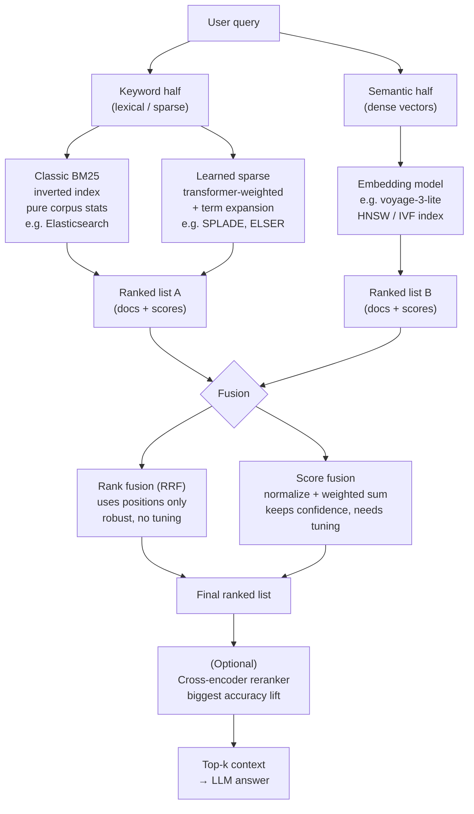

# Hybrid retrieval briefing: Elasticsearch, Team A

## Overview diagram

## How it does Hybrid search

Elastic search can run both keyword and vector search in one search request. A `standard` retriever finds keyword matches, a `knn` retriever finds text with similar meanings and finally an `rrf` retriever then combines both results. [Source: Elastic Documentation](https://www.elastic.co/docs/reference/elasticsearch/rest-apis/retrievers)

## Fusion and its defaults 
- Method: Reciprocal Rank Fusion (RRF), a rank based method.
- Defaults: `rank_constant = 60`, `rank_window_size = 10`, and each retriever’s weight is 1.0. The window controls how many results from each list are considered; the request’s size controls how many are returned.
- Weighting: Each retriever can have a `weight`. Setting keyword search to 2.0 and vector search to 1.0, allows keyword search to have twice as much influence once their results are combined. 

We would test a weight above `1.0` when one search method finds better results for important questions—for example, keyword search for exact codes like `LP-3307`. We would use our test results to decide which weight works best.[Source: RRF Parameters and Weighted example](https://www.elastic.co/docs/reference/elasticsearch/rest-apis/retrievers/rrf-retriever?)

## The keyword side 
Elasticsearch’s normal keyword search uses BM25 with an inverted index, which maps words to documents containing them. BM25 considers word frequency, word rarity and document length. [Source: How full-text search works](https://www.elastic.co/docs/solutions/search/full-text/how-full-text-works?)

## One catch 
BM25 and the RRF retriever are available in the free Basic tier, but if you want learned sparse out of
the box you are on a paid plan. [source](https://www.elastic.co/subscriptions)

## Evidence that hybrid helps

Microsoft tested Azure AI Search on nine BEIR datasets, using NDCG@10, which measures the relevance and ordering of the top ten results.

| Search Method  | NDCG@10 | 
|---|---|
| Keyword only | 40.6 |
| Vector only  | 45.0 |
| Hybrid | 48.4 |

Hybrid improved by 3.4 points over vector-only and 7.8 points over keyword-only. This is evidence from a vendor testing its own product, not an independent Elasticsearch benchmark. [Source: Microsoft comparison ](https://techcommunity.microsoft.com/blog/azure-ai-foundry-blog/azure-ai-search-outperforming-vector-search-with-hybrid-retrieval-and-reranking/3929167?)

## Advice for our app

### Should we add hybrid search?

**Not Elasticsearch, but yes to hybrid.** The one gap in our current retrieval is q24, an
exact-id lookup — exactly the case BM25 solves. Spinning up Elasticsearch for 16 documents
is heavy infra for a single failure mode. One lighter path with the same outcome:

**Not Elasticsearch unless** the corpus grows past ~10k chunks.

### Apply it to our app

## Chroma Cloud with native sparse + RRF.**
If we move to Chroma Cloud, hybrid comes built-in: We can add a BM25 sparse embedding function to the collection schema and run
`Rrf([Knn(dense), Knn(sparse)])` in one query. No separate BM25 service, no Python-side
fusion code. Chroma ships a built-in BM25 sparse embedding function that runs locally in
the client with no API key.
[source](https://docs.trychroma.com/cloud/search-api/hybrid-search)
[source](https://docs.trychroma.com/integrations/embedding-models/chroma-bm25)

## Core questions
1. Rank or score? Rank-based fusion avoids comparing incompatible score scales, but loses information about how far apart the original scores were. Score-based fusion rescales and combines scores, retaining those gaps, but depends on how scores are normalised. [Source: Weaviate fusion explanation. Weaviate Documentation](https://docs.weaviate.io/weaviate/concepts/search/hybrid-search?)
2. Does hybrid help? Microsoft’s comparison above shows a gain, although we must test whether it helps our own questions.
3. Where does the keyword half come from? Elasticsearch provides classic BM25. It also supports ELSER, a learned sparse model that produces weighted terms and can match related concepts beyond the original wording. [Source: BM25](https://www.elastic.co/docs/solutions/search/full-text/how-full-text-works?utm_source=chatgpt.com)[, ELSER](https://www.elastic.co/docs/solutions/search/vector/sparse-vector?)
